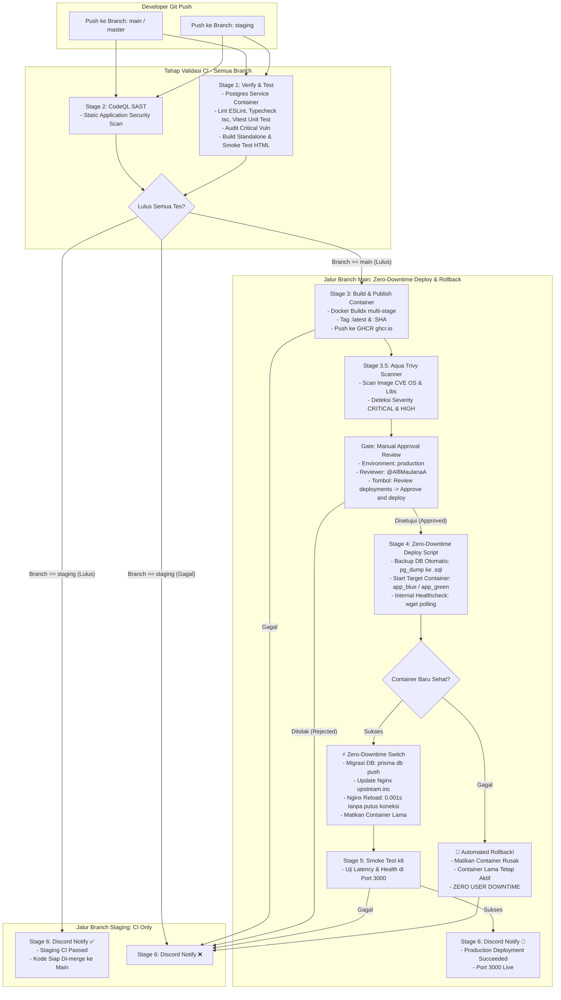

# 📘 Dokumentasi Lengkap Arsitektur CI/CD & Docker (NexaStore)

Dokumen ini menjelaskan secara menyeluruh bagaimana sistem **Continuous Integration & Continuous Deployment (CI/CD)**, **peran branch Staging vs Production**, **arsitektur kontainer Docker dengan Zero-Downtime Blue/Green Deployment**, **Automated Rollback**, **Trivy Container Security Scanner**, serta **panduan linting kode per folder** bekerja pada proyek ini.

---

## 🗺️ 1. Diagram Alur Kerja CI/CD (Staging: CI Only vs Production: Zero-Downtime Deploy)



---

## ⚙️ 2. Peran Masing-Masing Branch

| Branch | Peran / Fungsi | Alur Eksekusi CI/CD | Target Server Fisik |
| :--- | :--- | :--- | :--- |
| **`staging`** | **Garda Pengujian & Validasi (CI Only)** | Menjalankan seluruh test suite (Linting, TypeScript compile, Vitest unit test, Prisma migration test, Next.js build test, CodeQL security scan). | **Tidak menyentuh server fisik** (Aman dari bentrok port / downtime) |
| **`main`** / **`master`** | **Rilis Produksi (Continuous Deployment)** | Test CI $\rightarrow$ Build Image $\rightarrow$ Trivy CVE Scan $\rightarrow$ **Manual Approval Gate (@AlfiMaulanaA)** $\rightarrow$ **Zero-Downtime Deploy & Auto-Rollback** $\rightarrow$ k6 Smoke Test. | **Live di Port 3000** (`http://192.168.2.42:3000`) |

---

## 🚀 3. Rincian Step-by-Step Pipeline CI/CD (`deploy.yml`)

Pipeline didefinisikan pada [.github/workflows/deploy.yml](file:///.github/workflows/deploy.yml) dan terbagi menjadi tahapan berikut:

### 🔹 Tahap 1: Verify (`Test application and database`)
* **Lingkungan:** `ubuntu-24.04` dengan *service container* `postgres:16-alpine`.
* **Langkah-langkah:**
  1. `actions/checkout`: Mengambil kode sumber repository.
  2. `setup-node`: Menyiapkan runtime Node.js 22 dengan caching npm.
  3. `npm ci`: Instalasi dependensi secara bersih dan deterministik.
  4. `npx prisma generate`: Men-generate TypeScript client Prisma ORM.
  5. `npm run lint`: Memvalidasi aturan sintaks via ESLint.
  6. `npx tsc --noEmit`: Memvalidasi seluruh type safety TypeScript tanpa kompilasi file fisik.
  7. `npm run test:ci`: Menjalankan seluruh test suite unit testing via **Vitest** (13 test cases validasi form & input produk).
  8. `npm audit --omit=dev --audit-level=critical`: Memindai kerentanan dependensi berstatus kritis.
  9. `npx prisma db push & npm run seed`: Melakukan migrasi skema tabel ke database PostgreSQL uji coba dan mengisi data awal.
  10. `npm run build`: Memvalidasi kompilasi Next.js *standalone build*.
  11. `Functional smoke test`: Menjalankan server Next.js di background (`server.js`), lalu melakukan `curl` ke `http://127.0.0.1:3000/` untuk memverifikasi halaman HTML render string `NEXASTORE`.

### 🔹 Tahap 2: CodeQL (`CodeQL security analysis`)
* **Lingkungan:** `ubuntu-24.04`.
* **Tujuan:** Static Application Security Testing (SAST) otomatis untuk mendeteksi celah keamanan (seperti injection, XSS, prototype pollution) pada kode JavaScript/TypeScript sebelum dirilis.

### 🔹 Tahap 3: Build, Publish Container & Trivy Vulnerability Scan
* **Kondisi:** Dijalankan **HANYA** saat event `push` ke branch **`main`** atau **`master`**.
* **Langkah-langkah:**
  1. Menggunakan **Docker Buildx** dengan platform target `linux/amd64`.
  2. Memberi tag `:latest` dan `:<commit-sha>`.
  3. Mengaktifkan GitHub Actions cache (`type=gha`) agar build berikutnya berlangsung cepat.
  4. Mengunggah image ke **GitHub Container Registry (GHCR)** di `ghcr.io/alfimaulanaa/gspe-deployment`.
  5. 🔍 **Aqua Trivy Scanner:** Memindai kontainer image terhadap database CVE terkini untuk paket sistem operasi Alpine dan library aplikasi dengan tingkat keparahan *CRITICAL* dan *HIGH*.

### 🔹 Gate Khusus: Manual Approval Gate (`environment: production`)
* **Mekanisme:** Sebelum kontainer dideploy ke server fisik, GitHub Actions akan **berhenti sementara (PAUSE)** dengan status `Waiting for review`.
* **Reviewer:** Dibatasi hanya untuk reviewer yang ditentukan (akun GitHub `@AlfiMaulanaA`).
* **Cara Melakukan Approve:**
  1. Buka tab **Actions** di GitHub repository.
  2. Buka run pipeline yang sedang berjalan (akan ada tanda status kuning *Waiting for review*).
  3. Klik tombol **"Review deployments"**.
  4. Centang environment **production**, lalu klik tombol **"Approve and deploy"** (atau *Reject* jika ingin membatalkan).
* **Keuntungan:** Menghindari *accidental deployment* dan memberi Anda kontrol penuh kapan server produksi boleh di-update.

### 🔹 Tahap 4: Zero-Downtime Blue/Green Deploy & Automated Rollback (`scripts/deploy-production.sh`)
* **Kondisi:** Dijalankan setelah mendapat approval manual.
* **Lingkungan:** Runner `containment-server` di mesin fisik `192.168.2.42`.
* **Mekanisme Kerja:**
  1. **Automated DB Snapshot:** Sebelum migrasi skema tabel, runner otomatis membuat file backup database di `$HOME/GSPE-Deployment/backups/db-backup-$(date +%Y%m%d_%H%M%S).sql`.
  2. **Deteksi Active vs Target Container:** Runner mendeteksi container mana yang sedang melayani traffic (`gspe-app-blue` atau `gspe-app-green`). Versi baru akan diarahkan ke container yang sedang *idle* (lawannya).
  3. **Booting & Internal Health Check:** Image versi baru di-*pull* dan dijalankan pada target container. Runner melakukan *polling* internal `wget` ke port 3000 container baru selama 30 percobaan.
  4. 🔄 **Automated Rollback jika Gagal:** Jika container baru mengalami *crash / failure* saat booting, runner langsung mematikan target container baru, membatalkan deployment, dan **TIDAK MENGUBAH NGINX**. Container versi lama tetap melayani pengguna tanpa ada *downtime* sama sekali!
  5. ⚡ **Zero-Downtime Switch (Nginx Reload):** Jika container baru dinyatakan 100% sehat, database dimigrasi (`prisma db push`), pointer `upstream.inc` Nginx diarahkan ke container baru, dan Nginx me-reload konfigurasi dalam hitungan milidetik tanpa memutus koneksi pengguna yang sedang aktif.
  6. **Graceful Decommission:** Container versi lama dimatikan setelah Nginx sukses melayani traffic versi baru.
  7. **Disk Pruning:** Membersihkan image Docker usang (>72 jam).

### 🔹 Tahap 5: Post-Deployment Smoke Test (`smoke-test-production`)
* Menjalankan script **k6** ([loadtest/site.js](file:///loadtest/site.js)) langsung dari runner untuk menguji respon latency HTTP 200 di port **3000**.

### 🔹 Tahap 6: Discord Deployment Notification (`notify`)
* Berjalan otomatis (`if: always() && github.event_name == 'push'`).
* **Untuk Branch `staging`:** Mengirimkan pesan hijau `✅ Staging CI Passed` jika semua test valid, atau merah `❌ Staging CI Failed` jika ada error.
* **Untuk Branch `main`:** Mengirimkan pesan rilis `🚀 Production Deployment Succeeded (Port 3000 - Zero-Downtime)` lengkap dengan author, commit, dan link ke run logs.

---

## 🔍 4. Panduan Linting & Validasi Kode (ESLint)

### ❓ "Apakah untuk cek lint itu bisa ke spesifik folder?"
**JAWABANNYA: BISA BANGET!**

Secara bawaan, ESLint dapat diarahkan langsung ke path folder atau file tertentu yang ingin Anda periksa tanpa harus memindai seluruh proyek.

### 📌 Cara Menggunakan Linting Spesifik Folder:

#### 1. Menggunakan Script Pintas `npm run` (Di `package.json`)
```bash
# Periksa hanya folder components (ProductCard, Dashboard, ProductForm)
npm run lint:components

# Periksa hanya folder app (page.tsx, layout.tsx, Server Actions)
npm run lint:app

# Periksa hanya folder lib (prisma client, validasi produk)
npm run lint:lib

# Auto-fix kesalahan styling/formatting yang bisa diperbaiki otomatis
npm run lint:fix
```

#### 2. Menggunakan Argumen CLI Langsung
```bash
# Memeriksa folder spesifik
npx eslint src/components/
npx eslint src/app/actions/

# Memeriksa file spesifik saja
npx eslint src/components/ProductCard.tsx

# Melewatkan folder argumen melalui npm run lint
npm run lint -- src/components/

# Melakukan perbaikan otomatis (auto-fix)
npx eslint src/components/ --fix
```

---

## 🐳 5. Bedah Arsitektur File Docker (`Dockerfile`)

Aplikasi menggunakan **Multi-Stage Build** 3 lapis untuk efisiensi ukuran image dan keamanan maksimal:

* **Stage 1 (`deps`):** Mengunduh dan men-cache `node_modules` menggunakan `npm ci`.
* **Stage 2 (`builder`):** Men-generate Prisma client, mem-bundle script seed via `esbuild`, dan mengompilasi Next.js dengan mode `output: "standalone"`.
* **Stage 3 (`runner`):** Image minimalis berbasis `node:22-alpine` yang hanya menyalin folder `.next/standalone` dan aset statis. Berjalan di bawah user non-root `nextjs` (UID 1001) untuk keamanan enterprise, menghasilkan ukuran image yang sangat ramping (~150MB).

---

## 📦 6. Bedah Orkestrasi Container (`docker-compose.yml`)

Arsitektur kontainer di server fisik (`192.168.2.42`) menggunakan arsitektur **Reverse Proxy + Blue/Green Isolation**:

```text
[ Browser / Client ] ───> [ Port 3000 (Host) ]
                                   │
                                   ▼
                    [ gspe-nginx (Reverse Proxy) ]
                      (Port 80 internal / conf.d)
                                   │
              ┌────────────────────┴────────────────────┐
              ▼ (Active Upstream)                       ▼ (Standby / Testing)
     [ gspe-app-blue:3000 ]                    [ gspe-app-green:3000 ]
     (Next.js Standalone)                      (Next.js Standalone)
              │                                         │
              └────────────────────┬────────────────────┘
                                   │
                                   ▼
                        [ gspe-db (PostgreSQL 16) ]
```

* **Container `gspe-nginx`:** Menangani port host **`3000:80`**, melakukan terminasi koneksi dan mem-proxy ke aplikasi aktif dengan buffer TCP dinamis.
* **Container `gspe-app-blue` & `gspe-app-green`:** Berjalan di port internal 3000 (tanpa expose port ke host), bergantian aktif saat deployment rilis baru.
* **Container `gspe-db`:** PostgreSQL 16 Alpine berjalan di port **`5432`** dengan healthcheck bawaan `pg_isready`.
* **Isolasi Kredensial:** Seluruh username dan password diambil langsung dari file terlindung `/home/containment/GSPE-Deployment/.env`.
* **Folder Backups:** Terletak di `/home/containment/GSPE-Deployment/backups` yang otomatis menyimpan snapshot database setiap kali rilis dilakukan.
